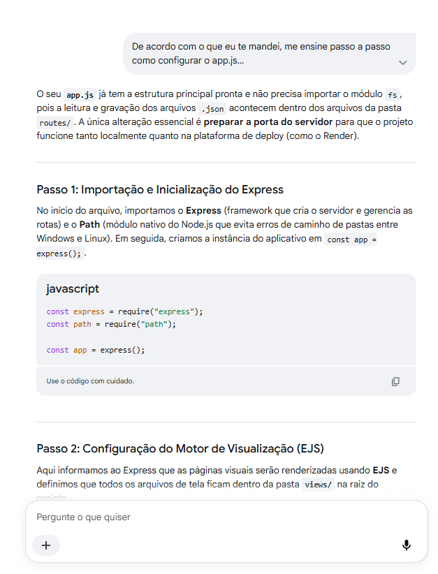
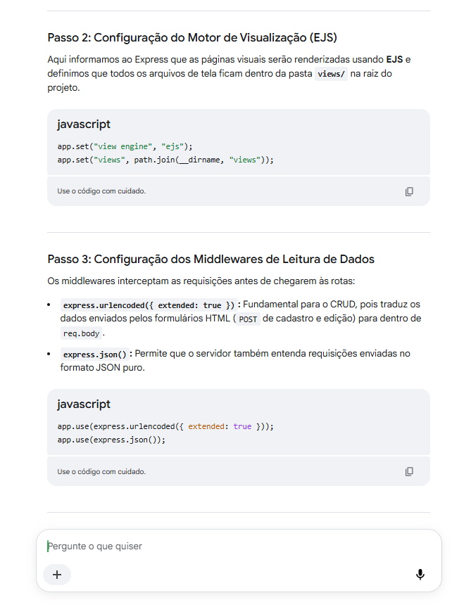
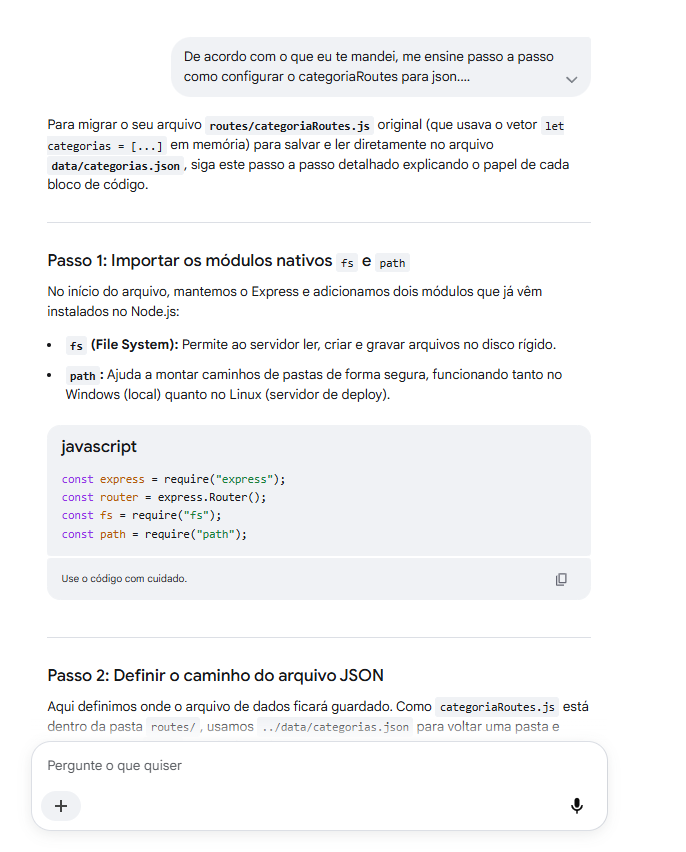
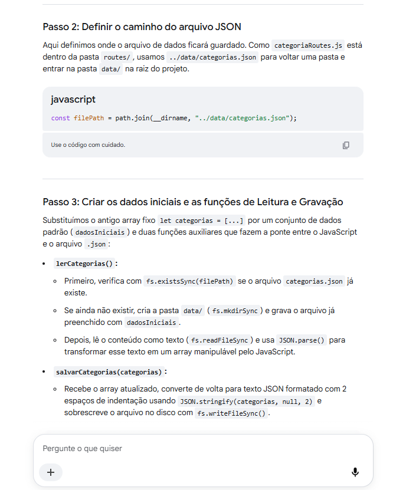
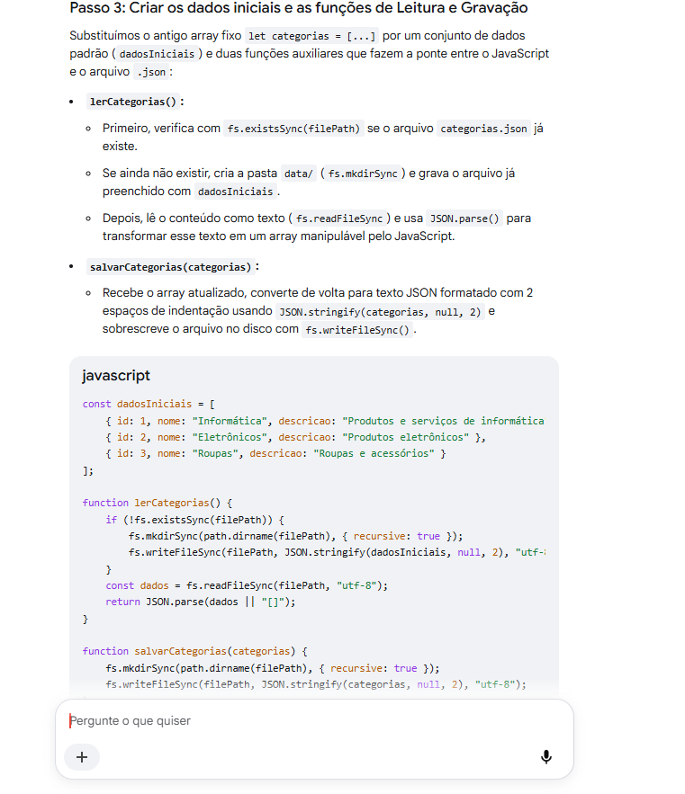
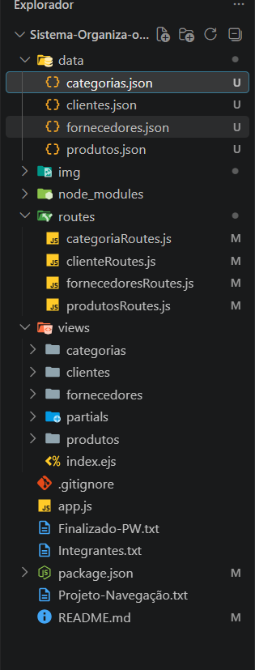
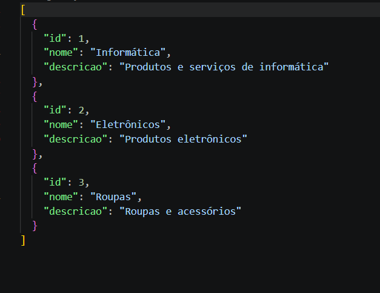
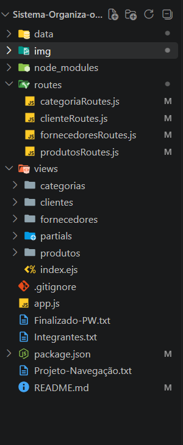

# Sistema de organização.
# (Sistema de Gestão Interna-Json (Categorias, Clientes, Fornecedores e Produtos).
# CRUD (Create, Read, Update e Delete).


# Integrantes:

Integrantes: Miguel da Silva Rodrigues, Nicolas Santos de Souza e Matheus Zaccarias.2ºDS.


# Objetivo:
O projeto consiste em um sistema CRUD (Create, Read, Update, Delete) totalmente funcional em JSON, podendo modificar as informações nos proprios arquivos. O objetivo principal desse projeto foi aplicar conceitos ensinados em aula e com a ajuda da IA aprender a reestruturar e reestilizar um site, deixando ele mais moderno e com menos poluição visual, além de aprendermos como migrar um projeto para JSON.

# Estruturas das pastas

```text
Sistema-Organiza-o-PW/
├── data/
│   ├── categorias.json
│   ├── clientes.json
│   ├── fornecedores.json
│   └── produtos.json
├── img/
│   ├── App.png
│   ├── App_1.png
│   ├── Categoria.png
│   ├── Categoria_2.png
│   ├── Categoria_3.png
│   ├── JSON.png
│   ├── Categoria-JSON.png
│   └── Geral-Organização.png
├── routes/
│   ├── categoriaRoutes.js
│   ├── clienteRoutes.js
│   ├── fornecedoresRoutes.js
│   └── produtosRoutes.js
├── views/
│   ├── categorias/
│   │   ├── editar.ejs
│   │   ├── form-cadastro.ejs
│   │   └── index.ejs
│   ├── clientes/
│   │   ├── editar.ejs
│   │   ├── form-cadastro.ejs
│   │   └── index.ejs
│   ├── fornecedores/
│   │   ├── editar.ejs
│   │   ├── form-cadastro.ejs
│   │   └── index.ejs
│   ├── partials/
│   │   ├── footer.ejs
│   │   ├── header.ejs
│   │   └── nav.ejs
│   ├── produtos/
│   │   ├── editar.ejs
│   │   ├── form-cadastro.ejs
│   │   └── index.ejs
│   └── index.ejs
├── .gitignore
├── app.js
├── Finalizado-PW.txt
├── Integrantes.txt
├── package.json
├── Projeto-Navegação.txt
└── README.md

```

# Entidades Utilizadas

O sistema gerencia 4 entidades principais, cada uma armazenada em seu respectivo arquivo JSON dentro da pasta `data/`:

1. **Categorias (`data/categorias.json`)**
   * `id` (Number): Identificador de categoria.
   * `nome` (String): Nome da categoria.
   * `descricao` (String): Descrição da categoria.

2. **Clientes (`data/clientes.json`)**
   * `id` (Number): Identificador do cliente.
   * `nome` (String): Nome completo do cliente.
   * `email` (String): E-mail do cliente.
   * `telephone` (String): Telefone do cliente.

3. **Fornecedores (`data/fornecedores.json`)**
   * `id` (Number): Identificador do fornecedor.
   * `rasaoSocial` (String): Razão social ou nome da empresa fornecedora.
   * `cnpj` (String): Cadastro Nacional da Pessoa Jurídica do fornecedor.
   * `email` (String): E-mail do fornecedor.
   * `telephone` (String): Telefone do fornecedor.
   * `cidade` (String): Cidade onde o fornecedor está localizado.

4. **Produtos (`data/produtos.json`)**
   * `id` (Number): Identificador do produto.
   * `nome` (String): Nome do produto.
   * `descricao` (String): Descrição do produto.
   * `preco` (Number): Valor do produto.
   * `estoque` (Number): Quantidade disponível em estoque.
   * `categoria` (String): Categoria do Produto.


# Prompt Utilizado

"Tenho um sistema CRUD desenvolvido em Node.js, Express e EJS onde os dados das entidades (categorias, clientes, fornecedores e produtos) estão armazenados em vetores (arrays) fixos dentro dos arquivos da pasta `routes/`. Preciso migrar esse armazenamento para arquivos JSON dentro de uma pasta `data/` (`categorias.json`, `clientes.json`, `fornecedores.json` e `produtos.json`), mantendo os registros iniciais e garantindo que todas as operações do CRUD diretamente nos arquivos JSON."


# Uso da Inteligência Artificial

A IA foi utilizada na fase de entendimento de como faríamos a migração do node.js para JSON, ela analisou o nosso código e nos ensinou passo a passo como migrar, ajudando tambem a substituir os arrays fixos podendo agora fazer o CRUD diretamente na pasta DATA nos arquivos JSON. Além de nos ajudar a resolver alguns erros e organizar o nosso arquivo para que ele não tivesse nenhuma falha na hora do DEPLOY.

# Alterações Realizadas

• Criamos uma pasta chamada `Data`

• Implementamos os arquivos JSON

• Tiramos os arrays fixos, podendo agora mudar as tabelas (CRUD), 
diretamente nos arquivos JSON dentro de Data (Implementação dos modulos nativos).

• Atualização do CRUD nos arquivos JSON.

• Agora as informações novas não irão sumir após o reinicio do projeto, 
pois agora ele fica armazenado no arquivos JSON.


obs: Conseguimos aprender como funciona essa migração além de ajustarmos o que a IA falou para melhorarmos, conseguirmos tambem nos aprofundar como funciona essa migração. 
Muito obr Profº Marcio.


# Como era armazenado anteriormente;

Armazenamento em memória (vetores estáticos-arrays): Anteriormente, todos os registros das entidades (**Categorias**, **Clientes**, **Fornecedores** e **Produtos**) ficavam guardados diretamente dentro dos arquivos da pasta `routes/`, declarados em variáveis `let` como vetores (arrays) fixos no código (por exemplo: `let categorias = [...]` e `let produtos = [...]`).

# Quais sugestões da IA foram aproveitadas no projeto

• A IA sugeriu criar funções separadas em cada arquivo de rota, assim centralizando a leitura e as escritas dos arquivos JSON, deixando assim o código mais limpo e organizado.

Assim não repetindo comandos como fs.readFileSync e fs.WriteFileSyn, 
dentro de cada rota do CRUD.

• A AI recomendou verificar se a pasta Data e os arquivos JSON existem antes de ler os dados, caso não, ele cria eles automaticamente com os registros que eu padronizei. Assim evitando o erro de ENOENT, tanto no computador quanto no DEPLOY.


# Desafios Encontrados

• Erro de diretório inexistente: Nos primeiros testes, o `fs.writeFileSync` apresentou erro ao tentar gravar os arquivos porque a pasta `data/` ainda não existia na raiz. O problema foi resolvido adicionando `fs.mkdirSync(path.dirname(filePath), { recursive: true })` para criar a pasta automaticamente quando necessário.

• Caminho errado da pasta `data/`: Houve uma confusão inicial ao criar uma pasta `data/` dentro de `views/`, enquanto todas as rotas apontavam para ela num local independente, quando percebi já arrumei e tudo começou a funcionar.

• Entendimento da migração: Pois não sabíamos por onde começar, então após algum tempo estudando com a ajuda da IA nos ensinando passo a passo, conseguimos entender como funciona utilizando o "path", data, JSON. Mas no final de tudo conseguimos aprender os principais conceitos e finalizamos o projeto.


# Evidências Visuais:

# Prints da Conversa com a IA:










 


 











# Links do Projeto:

• Link da Aplicação (Deploy):

• Link do Repositório GitHub: 


# Conclusão

Concluímos com sucesso a migração do sistema CRUD de vetores em memória para persistência em arquivos JSON na pasta `data/`. Todas as operações do CRUD estão funcionando de forma integrada aos arquivos `.json`, garantindo que os dados permaneçam salvos mesmo após reiniciar o servidor. Além disso, o uso da Inteligência Artificial foi fundamental para acelerar o aprendizado sobre manipulação de arquivos no Node.js com `fs` e `path` e estruturar o projeto de maneira limpa e organizada.

